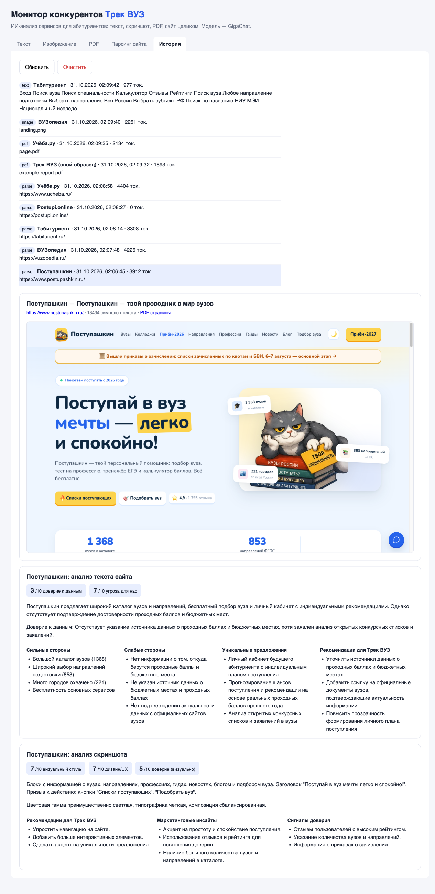
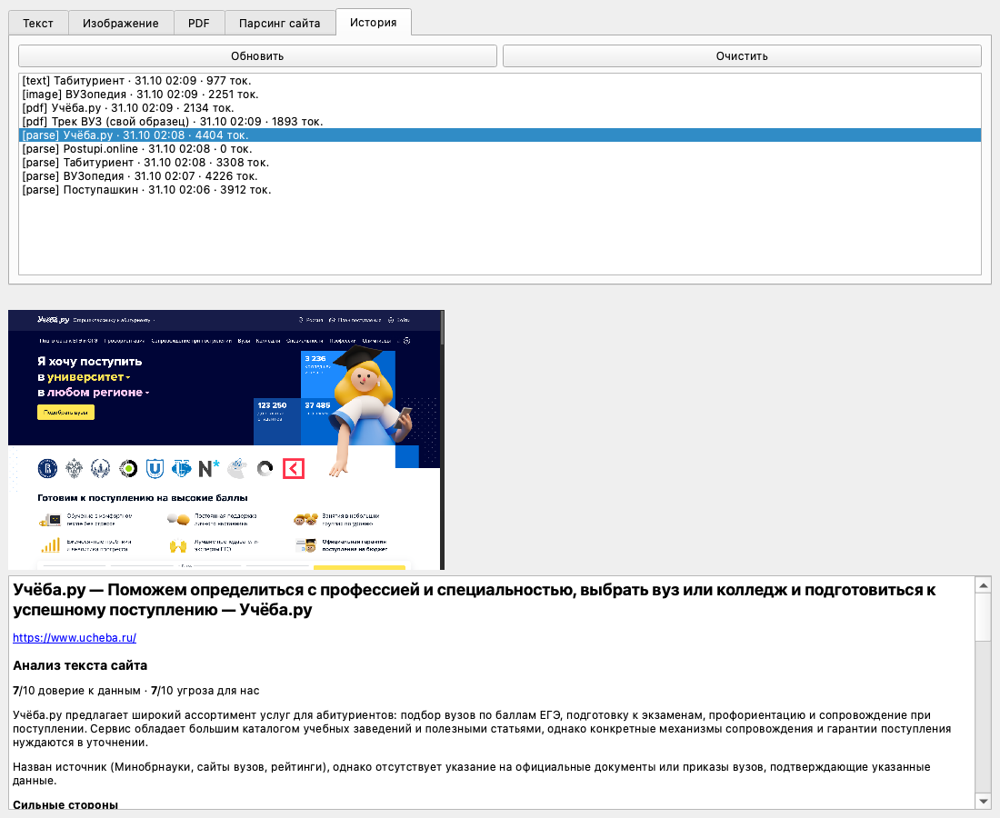

# Монитор конкурентов — Трек ВУЗ

Мультимодальный ИИ-анализатор конкурентов для ниши «подбор вуза для абитуриента». Он открывает сайты конкурентов в Chrome через Selenium, сохраняет скриншот, PDF и текст страницы, а затем GigaChat анализирует текст и скриншот. Результат приходит структурированным JSON: сильные и слабые стороны, уникальные предложения, оценки и рекомендации. Есть веб-интерфейс (FastAPI) и desktop-приложение (PyQt6 → один исполняемый файл).

Учебный проект (домашнее задание курса Zerocoder «Нейро», урок «Мультимодальный проект end-to-end»), построенный на реальном кейсе.



## Кейс

**Мы** — «Трек ВУЗ», бот в Telegram и MAX: платное исследование поступления по официальным документам вузов (бюджетные места, стоимость, проходной балл со ссылкой на документ).

**Конкуренты** — сервисы, которыми абитуриент пользуется вместо нас: Поступашкин, ВУЗопедия, Табитуриент, Postupi.online, Учёба.ру (адреса — в `config.py`, `COMPETITOR_URLS`).

**Чем ниша отличается от примера урока.** Главное здесь не дизайн, а то, можно ли верить цифрам. Поэтому к полям урока добавлены:
- `data_trust_score` (0–10) — насколько данные конкурента подтверждены документами вузов. Шкала с якорями: 9–10 — ссылка на документ и год, 6–8 — назван источник, 3–5 — цифры без источника;
- `threat_level` (0–10) — насколько конкурент закрывает ту же потребность, что и мы;
- `design_score` (0–10) — удобство: понятно ли за 5 секунд, что делать;
- `trust_score` и `trust_signals` — какие элементы на скриншоте реально видны и вызывают доверие у родителя абитуриента.

## Результаты прогона 31.10.2026 (GigaChat-2-Max)

- **Поступашкин** — угроза 8, доверие к данным 6, дизайн 8, доверие по скриншоту 8. Ближайший конкурент: бесплатно, личный кабинет, «кот-помощник». Заявляет «считаем только подтверждённые зачисления — по приказам вузов и статусам Госуслуг», но ссылок на документы не даёт.
- **ВУЗопедия** — угроза 7, доверие к данным 3, дизайн 7, доверие по скриншоту 0. Крупный каталог, квиз, персональный план; цифры без источников, на первом экране нет отзывов и цифр.
- **Табитуриент** — угроза 7, доверие к данным 3, дизайн 7. Каталог, отзывы, сообщество; источники цифр не указаны.
- **Учёба.ру** — угроза 8, доверие к данным 3, дизайн 7. Обещает «официальную гарантию поступления на бюджет» и сопровождение; цифры без источников.
- **Postupi.online** — не проанализирован: сайт отдаёт заглушку «доступен без VPN, просим отключить». Приложение распознаёт заглушку и не отправляет её модели.
- Для калибровки прогнали **свой продукт**. Образец отчёта Трек ВУЗ (PDF) получил доверие к данным 9. Сайт trekvuz.ru — доверие к данным 9, дизайн 7, но **доверие по скриншоту 0**: на первом экране нет ни отзывов, ни цифр, ни логотипов.

**Вывод для Трек ВУЗ.** «Проверено по официальным документам» — уже не уникальное обещание: Поступашкин говорит то же самое. Отстройка — в **ссылке на конкретный документ у каждой цифры** (её нет ни у кого из конкурентов) и в отчёте под город и специальность заказчика. Перенять у конкурентов стоит видимые сигналы доверия на первом экране: число вузов в базе, пример цифры со ссылкой на приказ, отзывы по мере появления. По данным мы сильнее всех конкурентов, а проигрываем подачей.

Сырые результаты лежат в `data/parse_demo_result.json`, `data/history.json` и `data/<конкурент>/` (там `landing.png`, `page.pdf`, `page.txt`).

## Архитектура

```
Вход: текст | скриншот | PDF | URL
        │
        ├─ URL → services/parsing_service.py (Selenium + Chrome): закрыть квизы/cookie → скриншот + PDF + текст
        │        └─ заглушка (VPN, капча, «пустая» страница) → в модель не отправляется
        ├─ PDF → pypdf (текст извлекается локально)
        ▼
services/gigachat_service.py — GigaChat-2-Max: текст → CompetitionAnalysis, картинка (attachments) → ImageAnalysis
        ▼
services/history_service.py — история в data/history.json (синглтон)
        ▼
Вывод: веб (FastAPI + frontend/) | desktop (PyQt6, desktop/app.py)
```

```
config.py               настройки, список конкурентов, описание нашего продукта
main.py                 FastAPI: эндпоинты
run.py                  запуск сервера
models/schemas.py       Pydantic-модели запросов и ответов
services/               gigachat_service, parsing_service, history_service, pipeline (общий для веба и desktop)
frontend/               index.html, styles.css, app.js
desktop/app.py          PyQt6-приложение
build.py                сборка в один файл (PyInstaller)
.github/workflows/      сборка .exe на Windows в GitHub Actions
data/                   собранные данные конкурентов и история
```

## Эндпоинты

- `GET /` — веб-интерфейс; `GET /docs` — Swagger.
- `POST /analyze/text` — `{"text": "...", "competitor": "..."}`.
- `POST /analyze/image` — form-data `file` (png/jpg) и `competitor`.
- `POST /analyze/pdf` — form-data `file` (pdf) и `competitor`.
- `POST /parse/demo` — `{"url": "...", "competitor": "..."}`; без `url` перебирает всех конкурентов из `config.py`.
- `GET /history`, `DELETE /history`, `GET /health`, `GET /competitors`.

## Установка и запуск

Нужны Python 3.11+ и Google Chrome. Chromedriver ставить не нужно: Selenium Manager скачает его сам.

```bash
python -m venv .venv
source .venv/bin/activate          # Windows: .venv\Scripts\activate
pip install -r requirements.txt
cp .env.example .env               # впишите GIGACHAT_AUTH_KEY
python run.py                      # или: uvicorn run:app --reload
```

Откройте http://127.0.0.1:8000.

Ключ GigaChat API выдаётся бесплатно (тариф Freemium) в [Studio Сбера](https://developers.sber.ru/studio). Сертификат УЦ Минцифры для TLS лежит в `certs/` — проверку SSL отключать не нужно.

## Desktop-приложение

```bash
python desktop/app.py              # запуск без сборки
python build.py                    # → dist/competition_monitor.exe (на Windows)
```

PyInstaller не собирает `.exe` на macOS или Linux. На Mac `build.py` даёт исполняемый файл для macOS; `.exe` собирает workflow **build-exe** в GitHub Actions (Actions → build-exe → Run workflow → Artifacts). Ключ в сборку не попадает: положите `.env` рядом с исполняемым файлом.

Проверка сборки без окна: `competition_monitor --smoke` (GigaChat) и `competition_monitor --smoke --parse` (Selenium и GigaChat Vision).



## Что выяснилось при доработке

1. **Заглушки вместо сайтов.** Postupi.online показывает пользователям с VPN страницу «отключите VPN», и модель оценила её как «минималистичный дизайн, доверие 8/10». Добавлена проверка заглушек (`stub_reason`): такие страницы в модель не отправляются.
2. **Всплывающие окна.** Квиз и cookie-баннер Поступашкина закрывали лендинг: в модель уходило 1 229 символов текста, а доверие по скриншоту получилось 0. После автозакрытия оверлеев — 13 434 символа и реальные сигналы доверия.
3. **Галлюцинации про нас.** Модель приписала Трек ВУЗ «гарантию поступления» — на самом деле это обещание Учёбы.ру. В промпт добавлено явное «чего у нас нет».
4. **Нестабильность оценок.** На одном и том же тексте GigaChat-2 (Lite) выдал доверие 8 / 7 / 4, GigaChat-2-Max — 6 / 6 / 6 (`data/stability_postupashkin.json`). Поэтому по умолчанию используется Max. Визуальные оценки остаются сигналом, а не метрикой.
5. **Selenium в PyInstaller.** Selenium 4.5x импортирует драйверы лениво, и без `--collect-all selenium` собранное приложение падает при запуске.

## Безопасность

Ключи хранятся только в `.env`, а `.env` внесён в `.gitignore`. На Mac владельца ключ можно не писать в файл: `config.py` возьмёт его из Keychain. В репозитории нет ни ключей, ни персональных данных — только публичные страницы конкурентов.
